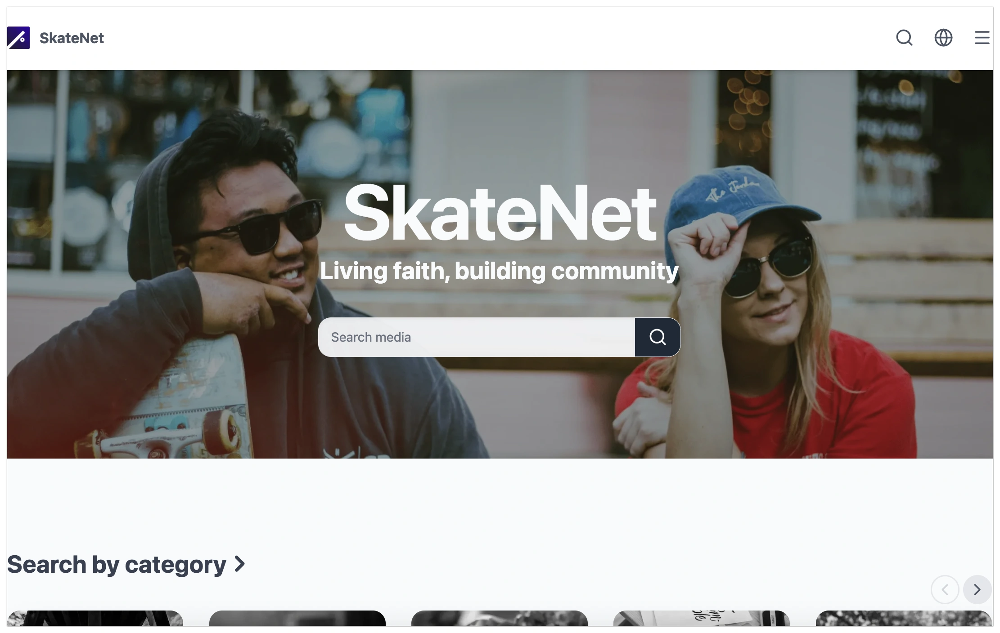
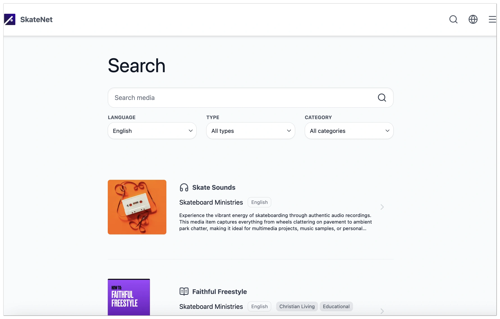
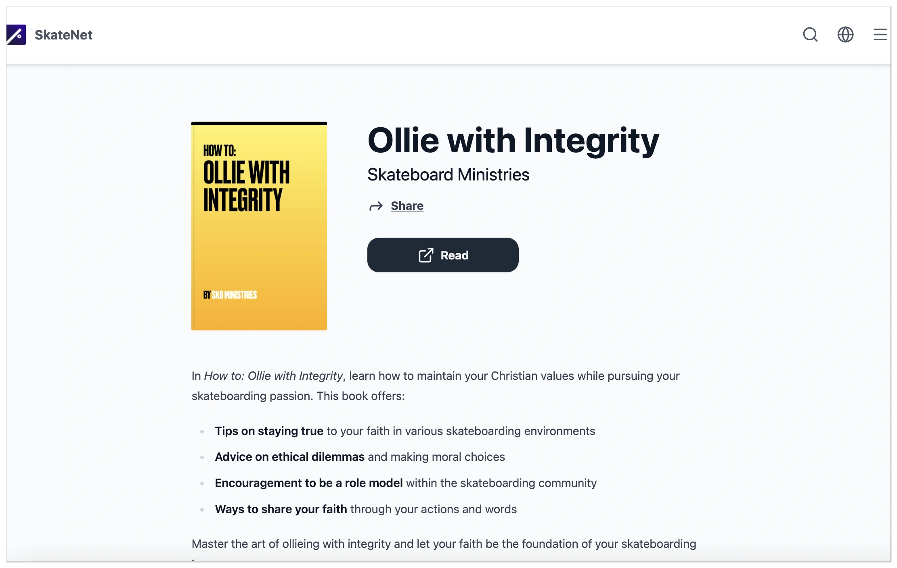
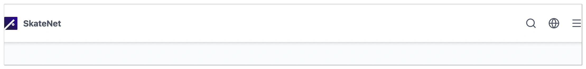
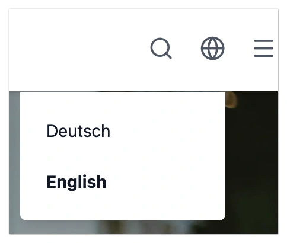
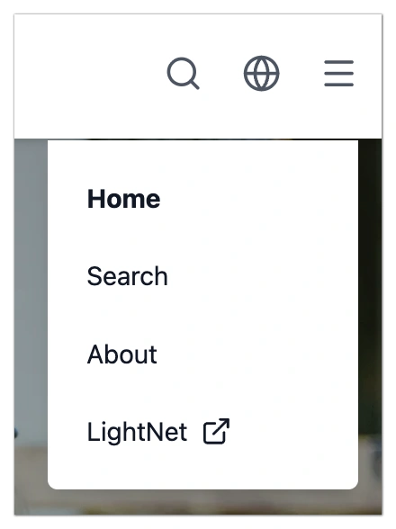
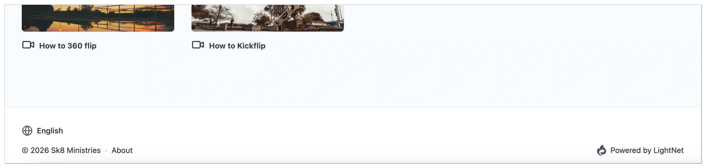
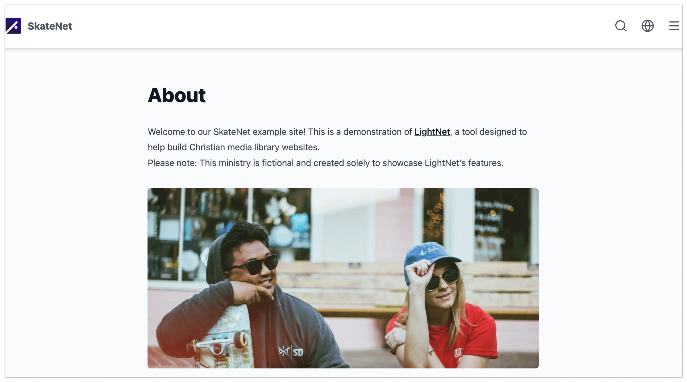

This page explains the structure of a media library built with LightNet and the implementation
details relevant to Site Administrators. It also explains key **LightNet terminology** used
throughout the documentation.

The screenshots on this page are from the running [example-template site](https://example-template.kuuluu.org/),
built from the [example-template project](https://github.com/LightNetDev/example-template).

## Media types

LightNet supports a wide range of media formats in a single Media Library. Examples include:

- Videos
- Audio
- Images
- Documents

[**Media Types**](/content/media-types) are configurable. A site can use format-based names
such as Videos or Audio, or Ministry-specific names such as Sermons, Books, or Podcasts.
A Media Library can include one or more Media Types.

## Media items

A [**Media Item**](/content/media-items) represents each piece of media content. Common Media Item
fields include:

- Title
- Content Language
- Media Type
- Cover image
- Content references (uploaded files or external links)
- Description

Each Media Item is represented by its own JSON file in the `src/content/media` folder. The file
stores the Media Item's metadata and contains references to Content, such as a video, audio file,
image, or document. The referenced Content may be stored on the LightNet Site or hosted elsewhere.

## Site navigation

See [LightNet Site navigation](/ministry/concepts/site-navigation) for a user-facing
overview of what Users see and how they navigate a LightNet Site.

## Homepage

The [**homepage**](/build/pages/initialize-homepage) is a customizable landing page. A Site
Administrator can configure it to display selected media items in [**gallery views**](/build/pages/media-gallery-section).

## Search page

The Search Page is accessible from the [**Header Bar**](#header-bar) by clicking the
**search magnifier icon**. It supports:

- Text searches for media items
- Filtering by [**Content Language**](/content/media-items#language), [**Media Type**](/content/media-types), or [**Categories**](/content/categories)

## Media item details page

The Media Item Details Page presents information about the Media Item, including its title,
description, Content Language, Media Type, and cover image, and provides access to its **Content**.
The layout of the Media Item Details Page is determined by its Media Type. The selected layout
controls how the cover image, Content, and metadata are displayed.
See [Media items](/content/media-items) for the complete list of Media Item properties.

## Header bar

The [**Header Bar**](/build/configuration/initialize-configuration) appears at the top of each page and contains:

- An optional **site logo**
- **Site title**
- **Search** icon
- **Language Selection** menu
- **Main Menu** icon

### Language selection

The **Language Selection Menu** is a control in the **Header Bar** that lists the configured
**Site Languages**. Selecting a different Site Language changes the **locale** and displays the
LightNet Site in the selected language. This does **not** translate **Media Items**: their titles,
descriptions, and other metadata remain in the original **Content Language**.
See [Internationalization fundamentals](/build/i18n/fundamentals) for how to configure Site
Languages and translations.

### Main menu

The **Main Menu**, opened via the three-line "hamburger" icon, allows navigation to:
- Internal pages, including Static Pages
- External websites

See [Main Menu configuration](/build/configuration/set-main-menu) for instructions and the
complete list of menu item properties.

## Footer

The optional [**footer**](/build/pages/footer) appears on every page. A Site Administrator
can configure footer text, links, and a “Powered by LightNet” credit.

## Static pages

Static Pages are custom pages that Site Administrators can create and link from the Main
Menu or Footer.

### About page

An About Page is a common example of a Static Page. Site Administrators can use it to
provide information about the Ministry or LightNet Site. See [Create an About Page](/build/pages/markdown-page) for details.

An About Page might include:

- A brief introduction to the site's purpose and mission
- Details about the organization or individuals behind the media content
- Contact information or links to related resources
- Copyright notices and legal disclaimers

